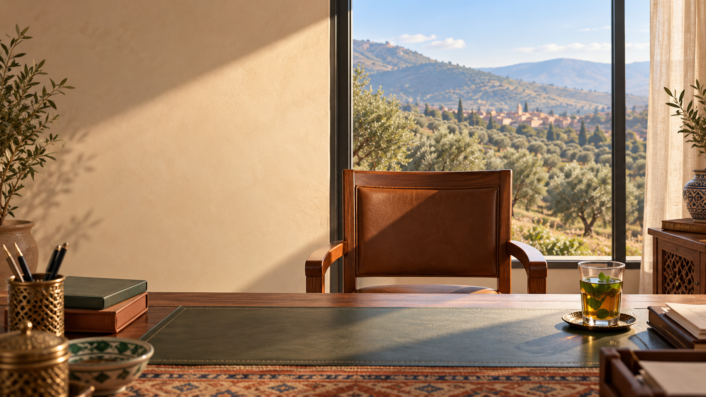
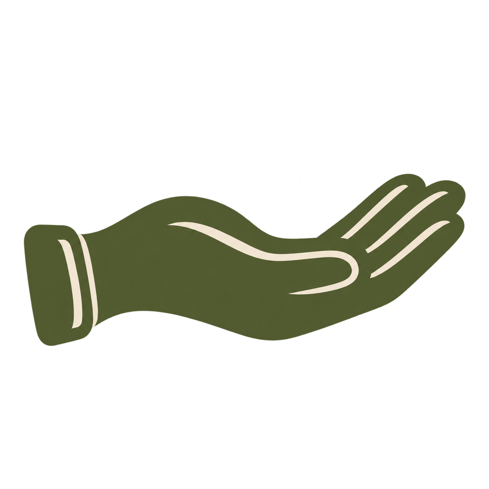
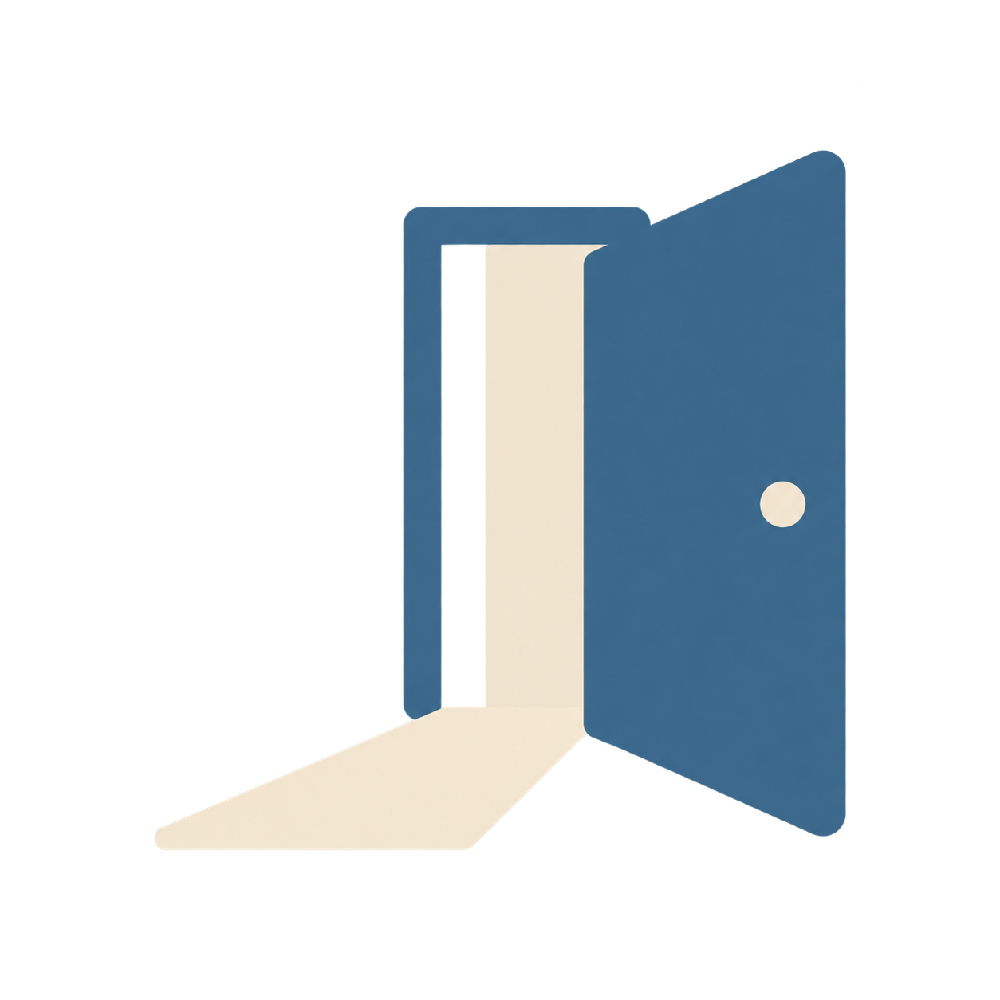

<!--
author:   André Dietrich
email:    LiaScript@web.de
version:  0.1.0
language: en
narrator: UK English Female
comment:  Module 1 of the course “Droits humains, droits des femmes et Loi 103-13” – human rights and women’s rights as a commitment Morocco has made itself. Teaser version, translated from German (draft translation, to be reviewed).
import:   https://raw.githubusercontent.com/LiaTemplates/pixijs/0.5.1/README.md
script:   ./assets/portraits/portrait-animation.js

translation: Arabic README.ar.md
translation: French README.fr.md
translation: German README.md
-->

# Human Rights and Women’s Rights



                                 --{{0}}--
Welcome to Module 1. You will accompany Khadija, a woman who came to a station a few years ago. You are on duty yourself, as Rachid or as Nadia, and you make three decisions. One run takes about eight minutes, followed by a quiz with six questions. The topic is violence within the family, but no violence is shown. You can pause at any time. And if you are affected yourself: you are not alone. The psychological service of your institution offers confidential support, and women’s counselling centres can help as well.

In this module you accompany Khadija, a woman who came to a station a few years ago. You are on duty yourself – as Rachid or as Nadia – and you make three decisions. Each one has consequences for Khadija.

* __Duration:__ about 8 minutes for one run, then a final quiz with 6 questions (passed from 80 %, that is 5 correct answers; can be repeated as often as you like).
* __Content:__ The topic is violence within the family. No violence is shown. You can pause at any time – the story will wait for you.
* __Characters:__ Khadija, Samira Bennani and all other characters are fictional, composed from many real experiences.
* __If you are affected yourself:__ You are not alone. The psychological service of your institution offers confidential support; women’s counselling centres can help as well.

__How to use the story:__

* Continue: click, space bar or Enter key
* Decisions: click them, reach them with the Tab key, or press the keys 1 and 2
* 🗣 switches reading aloud on and off, ↶ goes one step back, ↺ starts again
* Esc leaves the stage

The story begins on the page “Khadija’s story”.

## Khadija’s story

```text @Pixi.story
story modul1-en "Khadija – Module 1"
lang en-GB
option tts=on dim=on hint=on
bg   empfang     assets/images/hintergrund-empfang.png        alt="View across your desk into the reception area of a station: an empty chair, a glass of tea, a window with daylight"
bg   gespraech   assets/images/hintergrund-gespraechsraum.png alt="A quiet interview room with a small table, two chairs, a plant and a window with warm light"
bg   dorf        assets/images/hintergrund-olivenhain.png     alt="An olive grove in the hills near Sefrou, a small village in the morning light in the background"
bg   kooperative assets/images/hintergrund-kooperative.png    alt="The bright room of a women’s cooperative with olive oil, shelves and a large table"
bg   stadt       assets/images/hintergrund-stadt-schule.png   alt="A quiet street in a town with the entrance of a school in the morning"
image achten_symbol        assets/images/symbol-achten.png        type=courseimage height=0.24 y=0.39 alt="Symbol for respect: an open hand"
image schuetzen_symbol     assets/images/symbol-schuetzen.png     type=courseimage height=0.24 y=0.39 alt="Symbol for protect: a shield"
image gewaehrleisten_symbol assets/images/symbol-gewaehrleisten.png type=courseimage height=0.24 y=0.39 alt="Symbol for fulfil: an open door with light"
char samira  "Samira Bennani" type=courseportrait portrait=samira height=0.85 idle=none color=#2f6f8f voice="en-GB Female"
char khadija "Khadija" type=courseportrait portrait=khadija height=0.85 idle=none color=#7a8b3a voice="en-GB Female" pitch=1.1
char kollege "Driss, your colleague" type=courseportrait portrait=driss height=0.7 idle=none color=#8a7a5a voice="en-GB Male" pitch=0.85
char ich     "You"                 base:man color=#555555 voice="en-GB" pitch=0.95
char gedanke "Your thought"        base:man color=#999999 voice="en-GB" rate=0.9
var rolle = ""
var achten = 0
var schuetzen = 0
var gewaehrleisten = 0
// Extra scenes (travelling signature, sceptical colleague): 1 = teaser, 0 = final version
var vertiefung = 1

# start
show samira begruessung at center fade 0.6
samira: Welcome. I am Samira Bennani. I started out on patrol; today I train colleagues.
show samira neutral at center
samira: In this module you will accompany a woman who came to us at the station a few years ago. Her name is Khadija. Her story is invented – composed from many real experiences.
samira ernst: The topic is violence within the family. No violence is shown. If something comes too close, simply pause – the story will wait for you.
samira: You will make three decisions. Each one has consequences for Khadija. In which role are you on duty today?
? As Rachid – gendarme, 49 years old, 23 years of service -> s1b [rolle = "Rachid"]
? As Nadia – police inspector, 34 years old                -> s1b [rolle = "Nadia"]

# s1b
-> s2

# x1
if vertiefung == 0 -> x1_ende
title "1993" "Morocco accedes to the UN Convention on women’s rights (CEDAW)"
title "2011" "New Constitution, Article 19: men and women enjoy equal rights and freedoms"
title "Today" "Your desk"
samira: Morocco committed itself. This commitment is kept at a desk – at yours.
-> x1_ende

# x1_ende
return

# s2
hide samira fade 0.4
bg empfang fade 1
title "A Tuesday in autumn" "a few years ago"
: You are {rolle}, on duty at the front desk. Behind you, your colleague Driss is sorting files.
show kollege at far-left fade 0.5
show khadija schulmappe at center from offright 1s idle=none
khadija: It was a Tuesday in autumn. I had my daughter’s school papers with me. She was supposed to go to school in town – and he was against it.
khadija: I had never been inside a station before. Whoever is seen there, the village talks about. I spoke Tamazight, and only a little Darija.
if rolle == "Rachid": khadija schulmappe: Is there a woman here I can talk to?
if rolle == "Nadia": khadija schulmappe: You won’t tell anyone in the village, will you?
kollege skeptisch: A family matter. They sort that out at home.
if rolle == "Rachid": kollege: You and I both know how things work in the villages.
if rolle == "Nadia": kollege: One of your women’s issues, Nadia?
if vertiefung == 1 -> x2
-> d1

# x2
kollege: Honestly – we are not social workers. What happens inside a family is none of our business.
: What do you say to Driss?
? “A threat is not a private matter. The state has to protect her.” -> x2_gut
? “You’re right – but those are the rules.”                          -> x2_halb

# x2_gut
kollege nachdenklich: Hm. I had never looked at it that way.
-> d1

# x2_halb
kollege: Rules are rules. If you say so.
: Driss shrugs. A rule does not convince him – a reason might.
-> d1

# d1
if rolle == "Rachid": gedanke: Years ago, a woman stood here once before. You sent her home.
if rolle == "Nadia": gedanke: Fourteen open files. The shift changes in an hour.
: Khadija is standing in front of your desk. What do you do?
? I offer her a quiet place and a conversation in Tamazight. -> s3a [achten += 1]
? I quickly take her details at the counter – the queue is long. -> s3b
hotspot 0.72,0.08,0.22,0.30 -> pause1 "Window – take a breath"

# pause1
: You can pause at any time. The story will wait for you here.
-> d1

# notiz1
title "Note card – respect"
show achten_symbol at 28% fade 0.4
show samira notiz-verweisen at right fade 0.4
samira: Morocco made this promise to itself: in the Constitution of 2011, Article 19, men and women enjoy equal rights and freedoms.
samira: As early as 1979, Morocco ratified the two UN Covenants on human rights.
samira: And internationally: under Article 2 of the Universal Declaration of Human Rights, these rights apply without distinction – including sex or language.
samira notiz-verweisen: Respect means: we ourselves do not disadvantage anyone. Not even because someone does not speak our language.
hide samira fade 0.4
hide achten_symbol fade 0.4
return

# s3a
call notiz1
hide kollege fade 0.4
bg gespraech fade 1
show khadija at center fade 0.5 idle=none
if rolle == "Rachid": ich: Please sit down. We can speak Tamazight. And if you would rather talk to a woman, I will call a colleague from the support unit for women.
if rolle == "Nadia": ich: Please sit down. What you say here stays here. My colleague Amina speaks Tamazight, she will help us.
show khadija zugehoert at center
: Khadija puts the school bag on the table in front of her. Her hands loosen their grip on each other.
hide khadija fade 0.5
bg kooperative fade 1.5
khadija: The money from the cooperative – my share of the olive harvest – he takes it from me. Every month.
bg dorf fade 1.5
khadija: And he said: if I go to town with the little one, I will never see her again.
bg gespraech fade 1.5
show khadija traurig at center fade 0.5
khadija: All I want is for her to go to school.
-> d2a

# d2a
if rolle == "Rachid": gedanke: Reconciliation – you always thought that was the wisest way.
if rolle == "Nadia": gedanke: If you record this, it will be a long file.
: Khadija has told you about threats and withheld money. What do you do?
? I record the threats and the withheld money as a risk – even though it is her husband. -> s4a [schuetzen += 1]
? I suggest a conversation with both of them – this can be settled within the family. -> s4b
hotspot 0.72,0.08,0.22,0.30 -> pause2a "Window – take a breath"

# pause2a
: You can pause at any time. The story will wait for you here.
-> d2a

# s3b
call notiz1
hide kollege fade 0.4
hide khadija fade 0.8
: The chair in front of your desk is empty. Next to it stands a half-full glass of tea.
khadija: I left. At the counter, in front of all those people, I could not say what was going on.
khadija: Three weeks later I came back. This time early in the morning, when nobody was there.
show khadija schulmappe-traurig at center from offright 1s
khadija: He takes the money from the cooperative. And he says I will never see my daughter again if I leave.
-> d2b

# d2b
if rolle == "Rachid": gedanke: Reconciliation – you always thought that was the wisest way.
if rolle == "Nadia": gedanke: If you record this, it will be a long file.
: Khadija has come back. What do you do?
? I take her to the interview room and record the risk.                    -> s4c [schuetzen += 1]
? I note her visit and advise her to talk to her family first.             -> s4d
hotspot 0.72,0.08,0.22,0.30 -> pause2b "Window – take a breath"

# pause2b
: You can pause at any time. The story will wait for you here.
-> d2b

# notiz2
title "Note card – protect"
show schuetzen_symbol at 28% fade 0.4
show samira notiz-verweisen at right fade 0.4
samira: In 1993, Morocco acceded to the UN Convention on the Elimination of All Forms of Discrimination against Women, CEDAW. Article 2 obliges the state to eliminate discrimination against women, including by private persons. Morocco set out in a declaration of its own how it understands this article – more on that in the in-depth page.
samira: In 2011, Morocco lifted an earlier restriction on Article 16 – the article on marriage and family. Experts call such a restriction a “reservation”. The family is not a space outside the law.
samira notiz-verweisen-ernst: Protect means: we act, even when the danger comes from within the family.
hide samira fade 0.4
hide schuetzen_symbol fade 0.4
return

# notiz3
title "Note card – fulfil"
show gewaehrleisten_symbol at 28% fade 0.4
show samira notiz-verweisen at right fade 0.4
samira: Fulfil means: the rights must actually reach the woman. She leaves us with information in her language and a next step.
samira: The police, the gendarmerie, the courts and the hospitals have their own support units for women who have experienced violence. How to accompany women there, you will learn in the next modules.
hide samira fade 0.4
hide gewaehrleisten_symbol fade 0.4
return

# s4a
call notiz2
show khadija at center fade 0.5 idle=none
: The risk has been recorded. Khadija stands up, her bag in her hand.
khadija besorgt: And now? I have to be back before dark.
-> d3a

# d3a
if rolle == "Rachid": gedanke: What would the woman back then have needed?
if rolle == "Nadia": gedanke: Out there she is alone – in a language our forms do not speak.
: Before Khadija leaves – what do you do?
? I explain to her in Tamazight what happens now and where she can find help. -> s4a_ok [gewaehrleisten += 1]
? I tell her that we will be in touch as soon as something happens.            -> ende
hotspot 0.72,0.08,0.22,0.30 -> pause3a "Window – take a breath"

# pause3a
: You can pause at any time. The story will wait for you here.
-> d3a

# s4a_ok
call notiz3
-> ende

# s4b
call notiz2
bg empfang fade 1
show kollege at far-left fade 0.5
show khadija besorgt at center fade 0.5 idle=none
: Following your suggestion, Driss calls her husband.
show kollege telefon at far-left
kollege: He’ll be here in half an hour.
show khadija ellenbogen at center
: Khadija pulls her arms close to her body. One hand holds her own elbow.
khadija ellenbogen-traenen: I didn’t tell him I was here.
show kollege neutral at far-left
: A tear runs down Khadija’s cheek. Half an hour later her husband is standing at the front desk. Khadija does not say another word.
show khadija ellenbogen-traurig at center
-> d3b

# d3b
if rolle == "Rachid": gedanke: That is how it looked back then, too. Perfectly calm.
if rolle == "Nadia": gedanke: She asked you whether the village would find out. Now he is standing here.
: What do you do before the two of them leave?
? I speak with her alone once more and tell her where she can find help. -> s4b_ok [gewaehrleisten += 1]
? I let them go – after all, they have talked to each other.             -> ende
hotspot 0.72,0.08,0.22,0.30 -> pause3b "Window – take a breath"

# pause3b
: You can pause at any time. The story will wait for you here.
-> d3b

# s4b_ok
call notiz3
-> ende

# s4c
call notiz2
hide kollege fade 0.4
bg gespraech fade 1
show khadija at center fade 0.5 idle=none
: In the interview room you record the risk, in Tamazight. Khadija speaks quietly, but she tells you everything.
khadija zugehoert-gefasst: This time, someone listened to me.
-> d3c

# d3c
if rolle == "Rachid": gedanke: What would the woman back then have needed?
if rolle == "Nadia": gedanke: Out there she is alone – in a language our forms do not speak.
: Before Khadija leaves – what do you do?
? I explain to her in Tamazight what happens now and where she can find help. -> s4c_ok [gewaehrleisten += 1]
? I tell her that we will be in touch as soon as something happens.            -> ende
hotspot 0.72,0.08,0.22,0.30 -> pause3c "Window – take a breath"

# pause3c
: You can pause at any time. The story will wait for you here.
-> d3c

# s4c_ok
call notiz3
-> ende

# s4d
call notiz2
show khadija aufbruch at center flip
: You note her visit. Khadija nods, puts the school papers back in her bag and turns towards the door.
move khadija to left 0.6s
-> d3d

# d3d
if rolle == "Rachid": gedanke: Another one walking to the door.
if rolle == "Nadia": gedanke: The file is short. Is that a good thing?
: Khadija is already at the door. What do you do?
? I call her back and at least tell her where she can find help. -> s4d_ok [gewaehrleisten += 1]
? I wish her all the best – there is nothing more I can do here. -> ende
hotspot 0.72,0.08,0.22,0.30 -> pause3d "Window – take a breath"

# pause3d
: You can pause at any time. The story will wait for you here.
-> d3d

# s4d_ok
call notiz3
-> ende

# ende
hide all fade 0.8
if achten + schuetzen + gewaehrleisten == 3 -> e1
if achten + schuetzen + gewaehrleisten == 2 -> e2
if achten + schuetzen + gewaehrleisten == 1 -> e3
-> e4

# e1
bg kooperative fade 1.5
title "Khadija today"
show khadija beraterin at center fade 0.8 idle=none
khadija: Today I advise other women in our cooperative. My daughter is studying in Fès.
khadija: On that Tuesday, someone listened to me – in my language. That is where it all began.
call rueckblick
end e1_beraterin "Khadija now advises other women."

# e2
bg stadt fade 1.5
title "Khadija today"
show khadija zugehoert-gefasst at center fade 0.8 idle=none
khadija: I found the way to town on my own. It took longer. My daughter goes to school there.
khadija nachdenklich: At the station I was heard – but not completely.
call rueckblick
end e2_eigener_weg "Khadija found her own way – by a detour."

# e3
bg dorf fade 1.5
title "Khadija today"
show khadija gefasst at center fade 0.8 idle=none
khadija: Today I know where to find help. Back then I didn’t. A neighbour showed me the way – months later.
call rueckblick
end e3_spaet "Khadija found help – months later, somewhere else."

# e4
bg dorf fade 1.5
title "Khadija today"
show khadija ellenbogen-traurig at center fade 0.8
khadija: I went back. I stayed silent. Today my daughter asks me why.
call rueckblick
end e4_schweigen "Khadija went back."

# rueckblick
hide khadija fade 0.6
bg gespraech fade 1
show samira rueckblick at right fade 0.5
samira: Let us look back.
show achten_symbol at 28% fade 0.3
samira rueckblick-verweisen: Respect: {achten > 0 ? "fulfilled" : "missed"}.
if achten == 0: samira: Respect means: we ourselves do not disadvantage anyone – not even because of her language. That is what Morocco’s Constitution of 2011 and the Universal Declaration of Human Rights say.
hide achten_symbol fade 0.3
show schuetzen_symbol at 28% fade 0.3
samira rueckblick-verweisen: Protect: {schuetzen > 0 ? "fulfilled" : "missed"}.
if schuetzen == 0: samira: Protect means: we act, even when the danger comes from within the family. Morocco committed itself to this with CEDAW.
hide schuetzen_symbol fade 0.3
show gewaehrleisten_symbol at 28% fade 0.3
samira rueckblick-verweisen: Fulfil: {gewaehrleisten > 0 ? "fulfilled" : "missed"}.
if gewaehrleisten == 0: samira: Fulfil means: the rights must reach the woman – with information in her language and a next step.
hide gewaehrleisten_symbol fade 0.3
show samira rueckblick at right
if schuetzen == 0: samira: A woman who hesitates or draws back is often afraid. Fear is not a sign of uncertainty – it calls for protection, not for delay.
if achten + schuetzen + gewaehrleisten < 2: samira rueckblick-ernst: That Khadija remained alone for so long was not her failure. The help was missing.
if rolle == "Rachid": samira rueckblick-ernst: “The family will sort it out” – many of us learned that. Old habits are strong. Duty is stronger.
if rolle == "Nadia": samira rueckblick-ernst: The files pile up, time is short. But an hour for Khadija is not an hour lost.
if rolle == "Nadia": samira: And “your women’s issues”? Protection from violence is not a women’s issue. It is the duty of all of us.
call x1
samira: Khadija’s story is invented. The desks are real. You can start again at any time and choose a different path.
samira rueckblick-freundlich: And if you are experiencing or have experienced violence yourself: you are not alone. The psychological service of your institution offers confidential support, and women’s counselling centres can help as well.
return
```

After the story comes the final quiz on the page “Final quiz”. If you would like to know more, first have a look at the page “In depth: what Morocco has committed to”.

## In depth: what Morocco has committed to

                                 --{{0}}--
This page is optional and does not count towards the quiz. It recaps the three obligations. Respect means: we ourselves do not disadvantage anyone. Protect means: we act, even when the danger comes from within the family. Fulfil means: the rights reach the woman, with information in her language and a next step. Below you will find Morocco’s commitments from 1948 to 2022, important terms and five questions to open. Finally, the memory aid: Do I disadvantage her? Do I protect her? Does she leave with information and a next step?

> This page is an **optional in-depth page**. It recaps the three obligations and puts Morocco’s commitments into context. It does not count towards the final quiz.

__1. The three obligations – a short recap__

* <!-- style="width: 2.5em; vertical-align: middle" --> **Respect:** We ourselves do not disadvantage anyone – not because of sex, language or origin. *In the story:* offering Khadija a quiet place and an interpreter.
* <!-- style="width: 2.5em; vertical-align: middle" --> **Protect:** We act, even when the danger comes from private persons – including her own husband. *In the story:* recording the threats as a risk instead of calling it a “family matter”.
* <!-- style="width: 2.5em; vertical-align: middle" --> **Fulfil:** The rights must reach the woman. *In the story:* information in Tamazight and a next step – for example to the support unit for women at the police, the gendarmerie, the court or the hospital.

This is the threefold obligation the United Nations calls *respect, protect, fulfil*.

__2. Morocco’s commitments at a glance__

<!-- data-type="none" -->
| Year | Commitment | What it means for your work |
|---|---|---|
| 1948 | Universal Declaration of Human Rights | Rights apply without distinction as to sex or language (Art. 2) – the foundation, but not a treaty. |
| 1979 | Ratification of the two UN Covenants | Civil and political as well as economic, social and cultural rights are binding; Morocco reports regularly to UN committees. |
| 1993 | Accession to CEDAW | Art. 2: The state must eliminate discrimination against women, including by private persons. |
| 2004 | New Family Code (Moudawana, Law 70-03) | The family is the joint responsibility of both spouses; marriage age 18 (with judicial exceptions); women can also file for divorce. |
| 2011 | Withdrawal of the reservations to Art. 9(2) and Art. 16 of the Convention; new Constitution, Art. 19 | Marriage and family fall fully under equality; men and women enjoy equal rights and freedoms. |
| 2018 | Law 79-14 (Authority for Parity) and Law 103-13 on combating violence against women | More on this in Module 2. |
| 2022 | Optional Protocol to CEDAW enters into force | Women can turn to the UN Committee once domestic remedies have been exhausted. |

__3. Terms that are often confused__

* **Declaration or treaty?** The Universal Declaration carries great political weight, but it is not ratified. Covenants and conventions bind a state once it has ratified or acceded to them.
* **Reservation or declaration on a treaty?** A *reservation* excludes or limits a provision; a *declaration* states how a state understands a provision. Morocco withdrew reservations in 2011; some declarations, including one on Art. 2, remain in place.
* **Optional Protocol:** a separate treaty attached to the Convention. It allows individuals to submit a communication to the Committee – only once domestic remedies have been exhausted (Art. 4).
* **Due diligence:** The state is not liable for every act of a private person – but it is accountable for whether it prevents, investigates and protects with due diligence (CEDAW Committee, General Recommendation No. 19, para. 9, and No. 35, para. 24 b).

__4. Test yourself__ (open to see the answer, not graded)

<details><summary>What distinguishes the Universal Declaration from the UN Covenants?</summary>

The Declaration is not a treaty. Morocco ratified the Covenants in 1979 – they are binding.

</details>

<details><summary>Why did the withdrawal of the reservation to Art. 16 matter for everyday work?</summary>

Marriage and family fall fully under equality. “Family matter” is no reason not to act.

</details>

<details><summary>A colleague says: “The state is not responsible for violence by a husband.” What do you answer?</summary>

It is – because of due diligence, the state must also protect against violence by private persons. That is the obligation to protect.

</details>

<details><summary>Since when can women from Morocco turn to the UN Committee – and on what condition?</summary>

Since 2022, through the Optional Protocol. Condition: domestic remedies have been exhausted.

</details>

<details><summary>Which three questions do you ask yourself at the counter?</summary>

1. Do I disadvantage her? (respect)
2. Do I protect her, even if it is her family? (protect)
3. Does she leave with information and a next step? (fulfil)

</details>

> **Memory aid – three questions at the counter:** Do I disadvantage her? · Do I protect her? · Does she leave with information and a next step?

## Final quiz

Six questions about what you experienced in Khadija’s story – with new examples. You pass the quiz with 5 out of 6 correct answers (80 %). You can repeat it as often as you like. With ▶ you can have each question and its answers read aloud.

    {{|>}}
*****
**1.** A woman cannot read. She is told that her complaint will not be recorded without a completed form. Which obligation is missed here?

<!-- data-solution-button="false" -->
- [(X)] respect
- [( )] protect
- [( )] fulfil
****************************************
**Respect** means: we ourselves do not disadvantage anyone – not even because someone cannot read or does not speak our language. Under Article 2 of the Universal Declaration of Human Rights, rights apply without distinction.
****************************************
*****

    {{|>}}
*****
**2.** A young woman is being threatened online by an acquaintance. A colleague says: “What happens on the internet is a private matter.” Which obligation requires you to act anyway?

<!-- data-solution-button="false" -->
- [( )] respect
- [(X)] protect
- [( )] fulfil
****************************************
**Protect** means: we act, even when the danger comes from a private person. CEDAW obliges the state to eliminate discrimination against women, including by private persons.
****************************************
*****

    {{|>}}
*****
**3.** The risk has been recorded. The woman leaves with nothing but a leaflet in a language she cannot read. Which obligation is missed?

<!-- data-solution-button="false" -->
- [( )] respect
- [( )] protect
- [(X)] fulfil
****************************************
**Fulfil** means: the rights must reach the woman – with information in her language and a next step.
****************************************
*****

    {{|>}}
*****
**4.** Where has Morocco itself, in its own legal order, laid down that men and women enjoy equal rights and freedoms?

<!-- data-solution-button="false" -->
- [(X)] In the Constitution of 2011, Article 19
- [( )] In the Universal Declaration of Human Rights, Article 2
- [( )] In CEDAW, Article 16
****************************************
The **Constitution of 2011** is Morocco’s own commitment. The Universal Declaration of Human Rights and CEDAW are international sources that support this commitment.
****************************************
*****

    {{|>}}
*****
**5.** Which international commitment did Morocco accede to in 1993? Under it, the state must eliminate discrimination against women, including by private persons.

<!-- data-solution-button="false" -->
- [(X)] The UN Convention on the Elimination of All Forms of Discrimination against Women (CEDAW)
- [( )] The Universal Declaration of Human Rights
- [( )] The Constitution of 2011
****************************************
In 1993, Morocco acceded to **CEDAW**. Article 2 obliges the state to eliminate discrimination, including by private persons. In 2011, Morocco also withdrew its reservations to Article 16 (marriage and family).
****************************************
*****

    {{|>}}
*****
**6.** Finally, a case: A young woman tells you that her brother has threatened to lock her up if she keeps going to work. She asks you not to let her family know. What do you do?

<!-- data-solution-button="false" -->
- [( )] I call the brother so that the matter is settled quickly.
- [(X)] I record the threat as a risk and explain to her what happens now and where she can find support.
- [( )] I advise her to talk to her parents first – they know the brother best.
****************************************
Two obligations work together here: **protect** – the threat comes from within the family and is still a risk that you record. **Fulfil** – the woman leaves with information and a next step. Calling the brother or sending her to her parents ignores her request and can put her at even greater risk.
****************************************
*****

## Sources

1. Constitution of the Kingdom of Morocco of 2011, Article 19; Dahir No. 1-11-91 of 29 July 2011, Bulletin Officiel No. 5964 bis of 30 July 2011 — https://adala.justice.gov.ma/api/uploads/2024/02/28/costitution-1709118294788.pdf
2. Universal Declaration of Human Rights (1948), Articles 1 and 2
3. Convention on the Elimination of All Forms of Discrimination against Women (CEDAW), Articles 2 and 16 — ratification status of Morocco: https://tbinternet.ohchr.org/_layouts/15/TreatyBodyExternal/Treaty.aspx?CountryID=117&Lang=EN
4. Withdrawal of reservations in 2011: combined fifth and sixth periodic reports of Morocco to the CEDAW Committee — https://nwm.unescwa.org/sites/default/files/2023-09/combined-fifth-and-sixth-periodic-reports-cedaw-morocco-en.pdf
5. Accession to the Optional Protocol (in force 22 July 2022): https://treaties.un.org/doc/Publication/UNTS/No%20Volume/20378/A-20378-Morocco-08000002805e0a09.pdf
6. Law No. 79-14 on the Authority for Parity and the Fight against All Forms of Discrimination, Bulletin Officiel No. 6644 of 1 February 2018
7. Optional Protocol to CEDAW, Art. 4 (exhaustion of domestic remedies): https://www.un.org/womenwatch/daw/cedaw/protocol/text.htm
8. Family Code 2004 (Moudawana), Law No. 70-03; Dahir No. 1-04-22 of 3 February 2004, Bulletin Officiel No. 5184 of 5 February 2004 — Art. 4 (family under the joint responsibility of both spouses), Art. 19 and 20 (marriage age 18, exceptions only by a reasoned judicial decision), Art. 94 and 98 (divorce may also be requested by the wife)
9. CEDAW Committee: General Recommendation No. 19 (1992), para. 9, UN Doc. A/47/38; General Recommendation No. 35 (2017), para. 24 b), UN Doc. CEDAW/C/GC/35 — due diligence obligation of the state regarding violence against women by private persons
10. Law No. 103-13 on combating violence against women and implementing Decree No. 2-18-856 (2019): support units for women in the justice system, health system, police (DGSN) and gendarmerie — https://adala.justice.gov.ma/api/uploads/2025/10/23/decret%20%20n%C2%B0%202-18-856%20pris%20pour%20l'application%20de%20la%20loi%20n%C2%B0%20103-13-1761207383620.pdf
