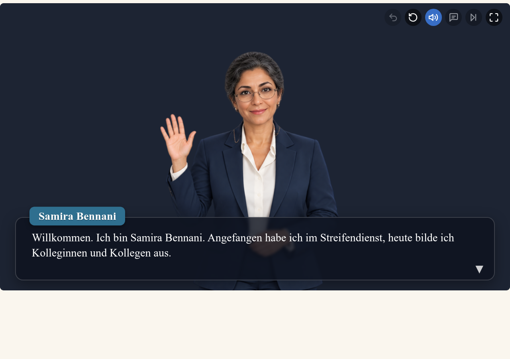
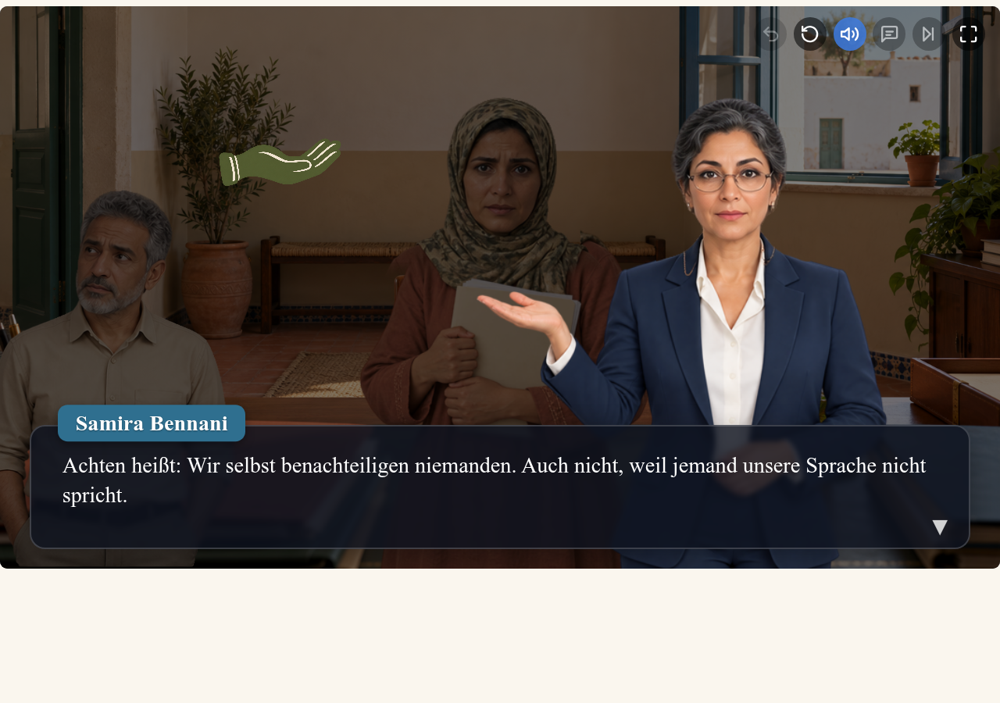
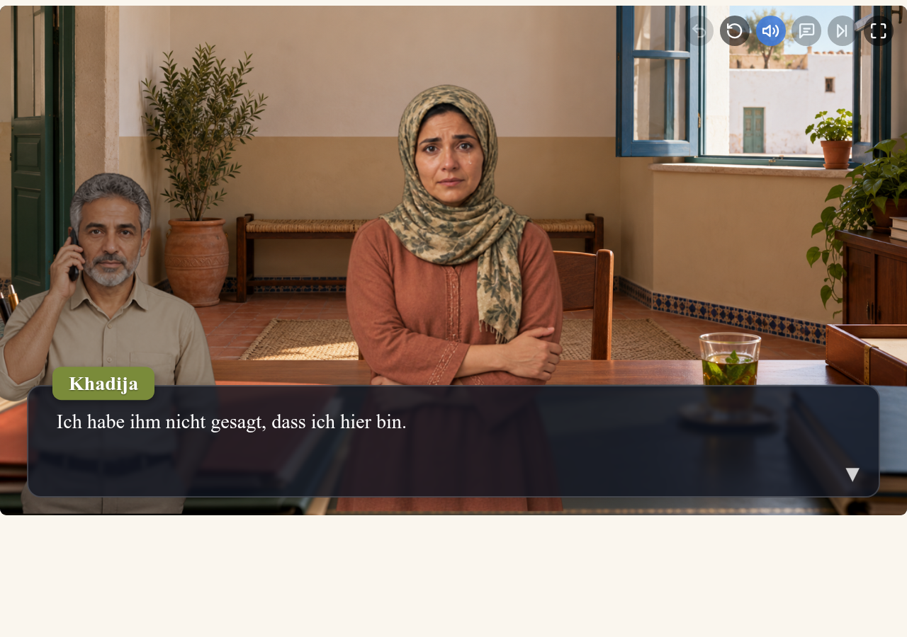
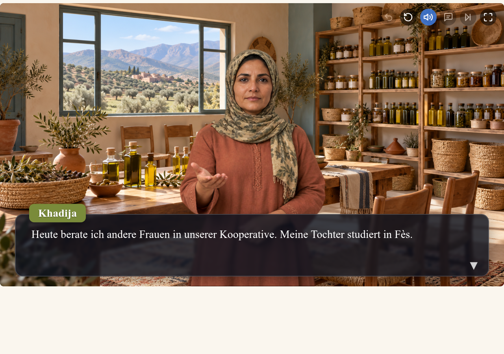

# Bildregie für Modul 1 – Überarbeitungsvorschlag

Stand: 18.10.2026. Grundlage: vollständige Entscheidungsgeschichte in README.md, Figurenübersichten von Samira und Khadija, bestehende Gesichtsanimation und lokaler PixiJS-Quellstand 0.5.0. Die unten dokumentierten Kernänderungen sind schrittweise umgesetzt und auf der Bühne geprüft. Die Szenentabelle hält auch weiterführende Vorschläge fest. Eine neuere veröffentlichte Vorlagenversion konnte über das Netzwerk nicht geprüft werden.

## Umgesetzt und geprüft

**Nachkorrektur nach Sichtung:** Khadija geht jetzt gespiegelt zur linken Tür. Samira hebt bei „achten“, „schützen“ und „gewährleisten“ eine Hand; das passende Symbol steht gemäß der rot markierten Bildschirmaufnahme weiter links und höher (`x=28%`, `y=0.39`). Das gilt für die drei Notizkarten und die nacheinander gezeigten Pflichten im Rückblick. Außerhalb dieser Passagen verwendet sie Ruheposen mit gesenkten Händen (die einmalige Begrüßung bleibt erhalten). [Türweg](assets/portraits/regie-tuer-links.png), [achten](assets/portraits/regie-notiz-achten.png), [schützen](assets/portraits/regie-notiz-schuetzen.png), [gewährleisten](assets/portraits/regie-notiz-gewaehrleisten.png).

1. Samiras Begrüßungs-, Erklär- und Verweisgeste; Erklärhände nach dem ersten Bühnentest höher gesetzt, Verweispose am Originalkopf ausgerichtet.
2. Hintergrundabdunklung bei allen drei Notizkarten und im Rückblick, Samira und Pflichtsymbole hell. Wiederherstellen und Rückkehr zur normalen Beleuchtung geprüft.
3. Khadijas Ellenbogenhaltung, traurige Variante mit einzelner Träne und Driss mit Telefon; nacheinander einzeln und in der Anrufszene geprüft.
4. Schulmappe bei Ankunft und Rückkehr, gelöste Haltung nach dem Zuhören, Aufbruch mit Mappe und Bewegung zum Bühnenrand, aktive Beratungsgeste im guten Ende.
5. Leerer Stuhl ohne Driss im Bild; Kooperative als zusätzlicher Erinnerungsraum zum Geldentzug; unterschiedliche Haltungen in den Enden.
6. Statische Pflichtsymbole repariert und über den Dialogkasten gesetzt. Die bisherige Bilddarstellung interpretierte `alt=` irrtümlich als zusätzlichen Bildpfad.

Alle 16 Rollen-/Entscheidungswege sind mit dem echten Story-Parser und Laufzeitmodell geprüft. Der vollständige Anruf-Verlauf und der gute Verlauf sind auf der PixiJS-Bühne durchlaufen; keine fehlenden Bilder, Parser- oder erfassten Browserfehler. Die LiaScript-Materialprüfung aus dem Modulordner zeigt 5 Seiten, 6 Quizfragen und 6 Vorleseelemente, ohne fehlende Bilder oder erfasste Fehler. Diese gezielten Prüfungen ersetzen keine neue fachliche Kursfreigabe.

Zusätzlich sechs feste Gesichtsansichten geprüft: Samira erklärt, Khadija mit Träne und Driss am Telefon jeweils beim Sprechen und mit geschlossenen Lidern. Die Träne bleibt sichtbar. Reduzierte Bewegung: kein automatisches Blinzeln, Abdunklung direkt bei 50 %. Alle zehn neuen PNGs: 448 × 512 px, RGBA mit transparenten und deckenden Pixeln. Die Bildbearbeitung erfolgte mit dem integrierten `imagegen`; die generierten Dateien wurden anschließend auf die gemeinsame Laufzeitgröße normiert. Prompts und Bilddateien stehen im Journal unter „Images“.

Die zusätzliche Akten-Geste von Driss und eine eigene Taschenpose wurden nicht produziert. Der Schwerpunkt liegt auf den für Entscheidungen relevanten Handlungen. Vor Veröffentlichung bleibt die bereits zurückgestellte Größenoptimierung der Bilder offen.

### Sichtbare Ergebnisse

| Begrüßung | Erklärung | Anruf | Khadija heute |
|---|---|---|---|
|  |  |  |  |

## Ziel

Die Folgen dienstlicher Entscheidungen sollen an sichtbaren Handlungen und Reaktionen verständlich werden. Gestik, Blickrichtung, Gegenstände, Bildraum und Licht unterstützen die drei Pflichten achten, schützen und gewährleisten. Auch ohne Weinen muss deutlich sein, dass Khadija Schutz braucht. Ihr Weg zur Handlungsfähigkeit bekommt ebenso viel visuelle Aufmerksamkeit wie ihre Angst.

## Szenenplan

| Szene / Skriptmarke | Befund | Vorgeschlagene Bildregie |
|---|---|---|
| Begrüßung / start | Samiras gefaltete Hände bleiben durchgehend gleich. | Eine offene Hand auf Schulterhöhe zur kurzen Begrüßung; anschließend beide Hände locker nach vorn geöffnet. Beim Inhaltshinweis ernst und ruhig, ohne Winken. |
| Ankunft / s2 | Die Schulpapiere werden genannt, sind aber nicht als Handlung sichtbar. | Khadija hält eine schlichte Mappe mit beiden Händen dicht am Körper. Blick zunächst zum Gegenüber, bei Driss' Einwurf kurz zu ihm. Der Eintritt endet vor dem Dialog; kein dauerhaftes Schwanken. |
| Driss / x2 | Seine Haltung ist überwiegend über Mimik und Text erkennbar. | Erst ein Unterarm auf einer Aktenmappe, Körper leicht abgewandt. Nach der begründeten Antwort Blick zum Gegenüber und offenere Haltung. Kein karikierendes Augenrollen. |
| Erste Entscheidung / d1 | Gefahr einer zu frühen visuellen Bewertung der Optionen. | Ruhige, unveränderte Bühne während der Auswahl. Keine grüne/rote Beleuchtung und kein vorweggenommenes Aufatmen. |
| Sicheres Gespräch / s3a | Ein Raumwechsel allein trägt die Entlastung. | Nach der Zusage von Sprache und Vertraulichkeit lockert Khadija ihren Griff um die Mappe; die Schultern sinken etwas. Sie bleibt ernst. Ein Lächeln wäre an dieser Stelle verfrüht. |
| Erinnerung / s3a, Dorf | Die Kooperative und der Schulwunsch sind nur erzählt. | Bei „mein Anteil an der Olivenernte“ das vorhandene Kooperativenbild, bei der Drohung das Dorf, bei „Ich will nur, dass sie zur Schule geht“ zurück ins Gespräch. Keine Gewaltbilder und keine bedrohliche Männerfigur ergänzen. Die Wechsel zunächst auf Lesbarkeit und Dauer prüfen. |
| Weggegangen / s3b | Der leere Stuhl ist bereits ein starkes Motiv; Driss bleibt derzeit sichtbar. | Driss für diesen Moment ausblenden, den leeren Stuhl und das Teeglas wirken lassen. Ein kurzer ruhiger Moment vor Khadijas Stimme, jederzeit weiterklickbar. Nach drei Wochen Rückkehr mit derselben Mappe, diesmal fester umklammert. |
| Gefährdung aufgenommen / s4a | „Und jetzt?“ erhält noch keine eigene Körperhaltung. | Khadija hält die Tasche zum Aufbruch, Körper leicht zur Tür, Blick aber zurück zum Gegenüber. Besorgnis bleibt trotz aufgenommener Gefährdung sichtbar. |
| Anruf beim Mann / s4b | Der zentrale Vertrauensbruch ist fast ausschließlich erzählt. | Drei Zustände: 1. Driss mit Telefon am Ohr; Khadija blickt zu ihm. 2. Bei „Er ist in einer halben Stunde da“ greift sie mit einer Hand den gegenüberliegenden Ellenbogen, zieht die Arme näher an den Körper. 3. Bei „Ich habe ihm nicht gesagt …“ gesenkter Blick, feuchte Augen, optional eine einzelne Träne. |
| Mann angekommen / s4b → d3b | Khadijas Verstummen wird nur beschrieben. | Sie dreht den Oberkörper etwas weg, hält den eigenen Arm und spricht nicht mehr. Die Ankunft bleibt über den vorhandenen Erzähltext verständlich. Kein neuer Ehemann als sichtbare Drohkulisse notwendig. Keine Kamerafahrt auf Tränen. |
| Zweiter Versuch / s4c | „Diesmal hat mir jemand zugehört“ wird derzeit freundlich gesprochen. | Erleichterung durch gelöste Hände und direkten Blick; ein kleines, zurückhaltendes Lächeln. Die Verletzlichkeit verschwindet nicht schlagartig. |
| Wieder abgewiesen / s4d | Einstecken der Papiere und Weg zur Tür bleiben Text. | Mappe an den Körper nehmen, leichte Dreivierteldrehung zur Tür, Position Richtung Bühnenrand. Bei Entscheidung d3d bleibt sie noch sichtbar und erreichbar. |
| Notizkarten / notiz1–3 | Samira erscheint neben der laufenden Szene; die Ebenen sind wenig getrennt. | Handlung visuell einfrieren. Hintergrund und anwesende Szenenfiguren abdunkeln, Samira und Pflichtsymbol hell lassen. Samira rechts: eine offene Hand weist zum passenden Symbol direkt darüber. Vor return die vorherige Beleuchtung wiederherstellen. |
| Gutes Ende / e1 | Gesichtsausdruck gefasst, aber gleiche Körperhaltung wie zuvor. | Aufrechte Khadija in der Kooperative, eine offene Hand zum Raum bzw. zu gedachten Gesprächspartnerinnen. Sie berät heute selbst: sichtbar handelnde Person. Kein triumphales Siegerbild. |
| Eigener Weg / e2 | Das Stadtbild trägt fast die ganze Veränderung. | Khadija mit Mappe seitlich am Körper statt als Schutz vor dem Oberkörper; aufrechte, ruhige Haltung, Blick zum Gegenüber. |
| Späte Hilfe / e3 | Gefahr, mit derselben Pose wie e1 dieselbe Wirkung zu erzeugen. | Gefasst und nachdenklich; Hände ruhig, kein Begrüßungs- oder Beratungsgestus. Ihre Worte tragen die Verzögerung. |
| Schweigen / e4 | Gefahr einer weiteren Wiederholung der traurigen Pose. | Geschlossene Armhaltung und abgewandter Blick, auf Augenhöhe. Keine zusätzliche Träne nötig; der Satz über die Tochter und die Stille reichen. |
| Rückblick / rueckblick | Samira steht wieder unverändert im Gesprächsraum. | Dieselbe dunkle Erklärungsebene wie bei den Notizkarten. Die drei Pflichten nacheinander mit passendem Symbol über der offenen Hand zeigen; bei den übrigen Sätzen Hände senken. Ernst bei fehlendem Schutz, freundlich beim abschließenden Unterstützungsangebot. |

## Figuren: überschaubares erstes Produktionspaket

Posen und Gesichtsausdrücke getrennt führen. Nicht jede Pose benötigt jeden Gesichtsausdruck. Zunächst die folgenden tatsächlich verwendeten Kombinationen herstellen:

1. **Samira begrüßt:** eine Hand offen auf Schulterhöhe, freundliches Gesicht; einmal beim Einstieg.
2. **Samira erklärt:** beide Hände locker nach vorn, Handflächen schräg nach oben; neutral und ernst.
3. **Samira verweist:** eine Hand zum Symbol auf der linken Bildseite geöffnet, Kopf weiter zum Publikum; neutral.
4. **Khadija mit Schulmappe:** beide Hände an der Mappe, Blick zum Gegenüber; unsicher.
5. **Khadija hält eigenen Ellenbogen:** eine Hand umfasst den gegenüberliegenden Ellenbogen, keine fremde Hand im Bild; besorgt, anschließend traurig mit optional einzelner Träne.
6. **Khadija gewinnt Halt:** Hände gelockert, Schultern weniger hoch, direkter Blick; gefasst.
7. **Khadija geht:** Mappe am Körper, Oberkörper leicht zur Tür; traurig.
8. **Khadija berät:** aufrecht, eine Hand offen; gefasst, dezentes Lächeln.
9. **Driss telefoniert:** Telefon am Ohr, sachlicher Ausdruck; nur beim Anruf.

Die bestehenden neutralen Posen bleiben als Ruhepositionen verwendbar. Gesten wechseln an inhaltlichen Wendepunkten, nicht im Takt jedes Satzes. Kein dauerndes Winken, kein künstliches Atmen durch Skalieren.

## Erklärungsebene und technische Umsetzung

Im Kurs steht bereits `option tts=on dim=on hint=on`. Im geprüften lokalen Stand von PixiJS 0.5.0 färbt `dim` nicht sprechende Figuren dunkler; der Hintergrund wird dadurch nicht abgedunkelt. `tint dark` ist vorhanden, liegt jedoch über Hintergrund **und** Figuren. Es erfüllt allein deshalb nicht den Wunsch nach einer weiterhin hellen Samira.

Für die gewünschte Erklärungsebene eine schwarze, weich eingeblendete Fläche zwischen Szeneninhalt und Erklärungselementen vorsehen: Hintergrund und Khadija/Driss darunter; Samira, Pflichtsymbol, Dialog und Bedienelemente darüber. Startwert für den visuellen Versuch: etwa 45–55 % Deckkraft und 0,4–0,6 Sekunden Überblendung. Das sind Gestaltungsvorschläge, noch keine getesteten Werte. Vor der Umsetzung prüfen, ob die vom Nutzer erwähnte neuere Version diese Ebenentrennung bereits unterstützt. Andernfalls über die vorhandene öffentliche Erweiterungsschnittstelle ergänzen; keine unbestätigten Skriptbefehle erfinden.

Beim Verlassen einer Notizkarte oder des Rückblicks sowie bei Neustart, Zurück und Laden eines Spielstands darf keine dunkle Ebene zurückbleiben. Pause-Hotspots und Entscheidungen bleiben bedienbar. Keine blinkenden oder roten Alarm-Effekte. Bei reduzierter Bewegung Posen direkt wechseln und Kamerabewegungen weglassen.

Die bestehende Erweiterung `courseportrait` wechselt bereits Körperbilder je Ausdruck. Für neue Posen lässt sie sich um eine eigene Pose-Auswahl und Kombinationen mit Ausdrücken erweitern. Aktuell sind Kopf- und Gesichtsebenen an feste Koordinaten gebunden: Kopfgröße, Augenlinie und Bildanker für neue Bilder beibehalten oder Registrierung je Kombination ergänzen. Neue Posen nicht ungeprüft mit alten Mund-/Lidmasken kombinieren. Gedrehte Köpfe und Tränen im Bereich der Lidmasken benötigen eine eigene Prüfung, damit Gesichtsteile oder Tränen beim Blinzeln nicht springen bzw. verschwinden.

## Würde, Verständlichkeit und Kontinuität

Eine einzelne Träne in einer halbnahen Darstellung ist mit der bisherigen Grenze „keine weinenden Großaufnahmen“ vereinbar. Dauerhaftes Weinen würde die abgestufte Entwicklung verflachen. Khadija muss auch ohne Tränen als glaubwürdig und schutzberechtigt erscheinen. Ihre geschlossene Haltung darf im Rückblick nicht als persönliches Versagen gelesen werden; Samiras vorhandener Satz „Die Hilfe hat gefehlt“ bleibt wichtig.

Mappe, Tasche und Telefon nur dort zeigen, wo sie gebraucht werden; Übergaben und Verschwinden nachvollziehbar gestalten. Bildsprache bleibt ohne Schrift, damit dieselben Bilder in Deutsch, Französisch und Arabisch funktionieren. Wesentliche Handlungen wie Anruf, Griff an den eigenen Arm und Verstummen auch im zugänglichen Erzähltext beschreiben. Farbe und Mimik allein tragen keine Lerninformation.

## Reihenfolge für die Umsetzung

1. Samiras Begrüßungs-/Erklärposen, Khadijas Ellenbogenhaltung und Driss mit Telefon produzieren; Identität und Gesichtsmasken im Vergleich zu den vorhandenen Figuren prüfen.
2. Erklärungsebene an genau einer Notizkarte erproben, inklusive Rückkehr in die Szene.
3. Anrufszene als vollständige Folge aus Handlung, Reaktion und Verstummen umsetzen.
4. Mappe, Aufbruch und aktive Schlussposen ergänzen; anschließend alle Verzweigungen auf Figuren-, Licht- und Gegenstandskontinuität prüfen.
